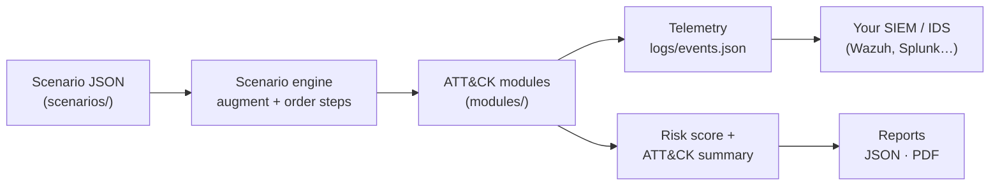

# RedSim: MITRE ATT&CK Adversary Simulation Platform


RedSim runs scripted attack scenarios (APT29, ransomware, insider threat, supply chain and more) against an **isolated lab** and produces the telemetry a real intrusion would leave behind. SOC teams and students can use it to check whether their SIEM rules, IDS signatures and playbooks actually fire, without touching real malware.

> ⚠️ **Safe by design.** RedSim contains no exploits or malware. Every module is a benign simulation primitive that works on dummy lab data and writes log events. `SAFE_MODE` is on by default. See [SECURITY.md](SECURITY.md).

## Features

- **13 scenario profiles** written as JSON: APT29, full kill chain, ransomware, phishing chain, credential abuse, lateral movement, privilege escalation, persistence-heavy, exfiltration campaign, insider threat, supply chain, web attack and SOC validation
- **9 ATT&CK-mapped modules:** recon (T1082), credential access (T1110), defense evasion (T1218), privilege escalation (T1548), lateral movement (T1021), persistence (T1547), exfiltration (T1041), ransomware impact (T1486) and cleanup (T1070)
- **Kill-chain augmentation:** the engine fills in any missing tactic so every run exercises the full chain
- **Risk scoring:** each step adds to a cumulative risk score, and the report maps every executed technique back to ATT&CK
- **Reports:** JSON for SIEM ingestion and PDF for stakeholders, with mitigation recommendations based on the techniques seen
- **JSON-Lines event log** (`logs/events.json`) ready to ship to Wazuh, Splunk or Elastic
- **CI:** GitHub Actions runs flake8, a Bandit security scan and schema validation of every scenario

## How it works



## Quick start

```bash
git clone https://github.com/Pzycokid/redsim.git
cd redsim
pip install -r requirements.txt
mkdir logs

# check that every scenario is valid
python validate_scenarios.py
```

Run a scenario and generate reports:

```python
import json
from config import SCENARIO_DIR
from utils.logger import setup_logger
from scenario_engine import ScenarioSimulationEngine
from report import generate_report

log = setup_logger()
scenario = json.load(open(SCENARIO_DIR / "apt29.json"))
results = ScenarioSimulationEngine(scenario, log).execute()

print(results["status"], results["risk_score"], results["mitre_summary"])
generate_report(results, ["json", "pdf"], log)   # written to reports/json and reports/pdf
```

Example output:

```
success 655 ['T1082', 'T1110', 'T1547', 'T1021', 'T1041', 'T1218', 'T1548', 'T1486', 'T1070']
```

## Writing a scenario

```json
{
  "name": "APT29 Mock Sequence",
  "attacker_profile": "Advanced Persistent Threat (APT29)",
  "category": "Advanced Intrusion",
  "steps": [
    {"id": "step_1", "technique": "T1082", "name": "Target Profile Initialization", "module": "recon", "enabled": true},
    {"id": "step_2", "technique": "T1110", "name": "Credential Access Mapping", "module": "credential_access", "enabled": true}
  ]
}
```

Drop the file in `scenarios/` and run `python validate_scenarios.py`.

## Project structure

```
redsim/
├── scenario_engine.py      # loads scenarios, runs modules, collects results
├── report.py               # JSON / PDF report generation
├── config.py               # paths, SAFE_MODE, risk thresholds
├── validate_scenarios.py   # schema check used in CI
├── modules/                # one ATT&CK-mapped simulation module per tactic
├── scenarios/              # 13 scenario profiles (JSON)
└── utils/                  # logging, MITRE mapping, scoring, validation
```

## Related projects

RedSim is the red side of my home SOC. Its telemetry is detected and triaged by:
[wazuh-soc-lab](https://github.com/Pzycokid/wazuh-soc-lab) · [suricata-ids-lab](https://github.com/Pzycokid/suricata-ids-lab) · [blueshield](https://github.com/Pzycokid/blueshield) · [attack-detection-lab](https://github.com/Pzycokid/attack-detection-lab)

## Disclaimer

For authorized security research, education and isolated lab use only. Licensed under the terms in [LICENSE](LICENSE).
